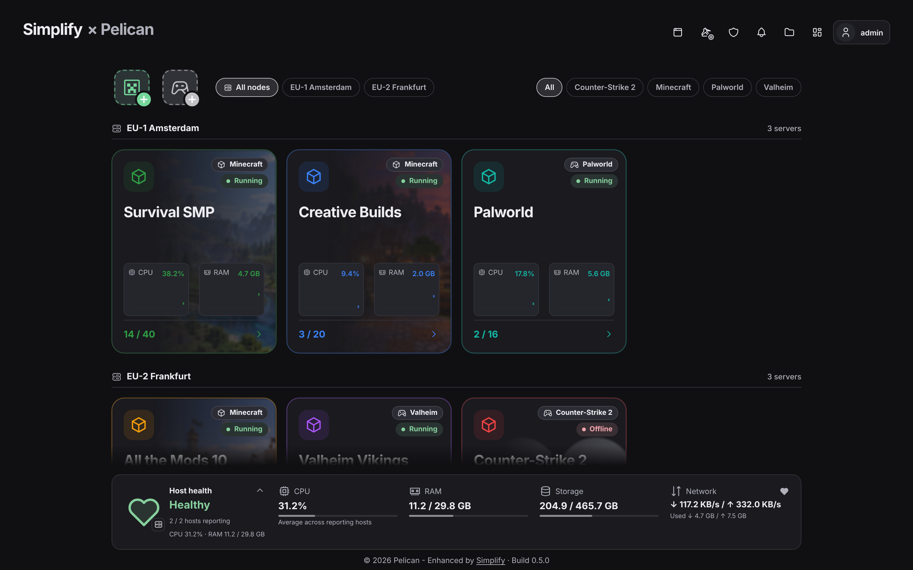
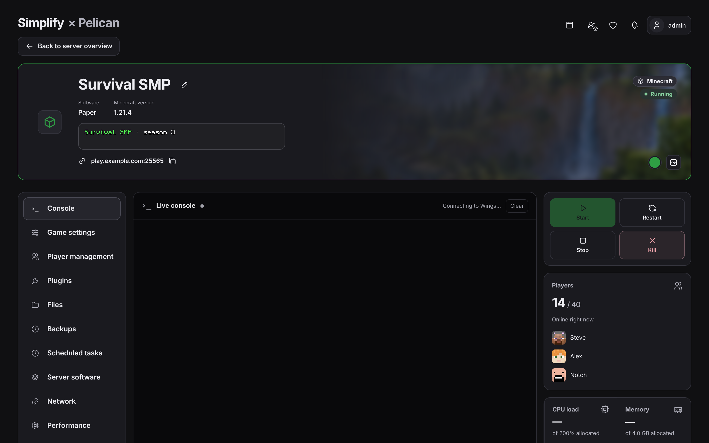
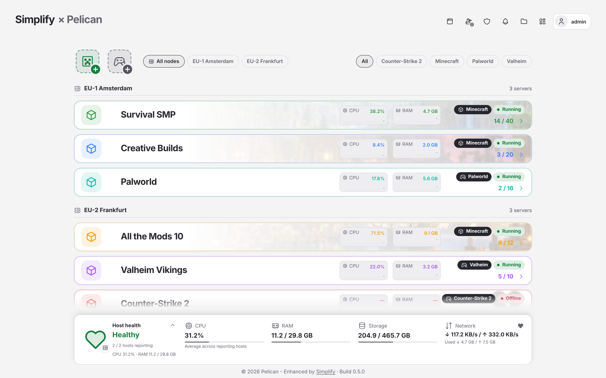

# PelicanSimplify

A cleaner, simpler interface for the [Pelican](https://github.com/pelican/panel) game server panel. You manage your servers from one overview and create new ones with a guided wizard. Everything still runs on Pelican and [Wings](https://github.com/pelican/wings), and the original panel stays available.

**Stable 0.4.0 for Pelican 1.0.0-beta38 · Release candidate 0.4.1-rc.2 (adds Pelican 1.0.0-rc.1 support) on the beta channel · PHP 8.3+**

*Screenshots use example servers.*

## Highlights

- **One overview for all servers:** live status, players, CPU and RAM at a glance, in a grid or list view.
- **Guided server creation:** pick Minecraft (Vanilla, Paper or a modpack) or search 170+ other games; Simplify picks and installs the right egg.
- **Simple and host mode:** simple mode suits a few servers. Host mode adds a server list per node and the admin pages side by side, for larger hosts.
- **Make it yours:** light and dark themes, server colors, banners, and your own logo or styled panel name.
- **Friends mode, people and roles:** everyone can see every server but only manage their own, and roles set clear permissions and limits.

## Before you install

Simplify is a large change to how your panel looks and works. Please read this first.

- **It replaces a lot of the panel.** The server overview, the server pages and server creation become Simplify's. Optionally it also takes over the Users, Roles and Plugins pages, and admins can use host mode.
- **Everything can be switched off.** Each part has its own switch in Simplify settings, and you can turn off the whole Simplify dashboard. Pelican's original panel always stays available: the Legacy links in Admin tools lead to it, and even if you hide those links the pages keep working.
- **It does not touch your running servers.** Servers, eggs, nodes and permissions stay Pelican's own. Simplify is a different way to look at and manage them.
- **Other plugins are only partly supported inside Simplify.** They keep working in Pelican's original panel. In stable 0.4.0 their pages do not show up in Simplify; release candidate 0.4.1-rc.2 shows their admin and server pages under "External". Widgets and tiles from other plugins are not supported yet. Full plugin support is the top item on the roadmap (see Coming features).
- **Make a backup before installing**, as with any plugin that changes this much.

## Getting started

1. In Pelican, go to **Admin → Plugins → Import from URL**.
2. Paste the link to the [latest stable plugin ZIP](https://github.com/jerajerajerajera/PelicanSimplify/releases/download/v0.4.0/pelican-simplify-v0.4.0.zip) and click **Install**. All versions are on the [Releases page](https://github.com/jerajerajerajera/PelicanSimplify/releases).

   **Beta channel:** the newest beta is always at `https://raw.githubusercontent.com/jerajerajerajera/PelicanSimplify/main/dist/pelican-simplify-beta-latest.zip`. Betas get new features first but are less tested. It currently holds release candidate 0.4.1-rc.2, with Pelican 1.0.0-rc.1 support and pages from other plugins; see the [changelog](CHANGELOG.md).
3. Follow the setup checks. Anything missing is shown with how to fix it.

**Requirements:** Node.js 22.12+ or 24+, Yarn, and a running queue worker and scheduler.

**Updates:** Simplify updates itself through its plugin manager, with a backup and automatic rollback. You always get the build made for your Pelican version. Stable releases are the default; turn on "Get Simplify beta versions" in Simplify settings → Plugin manager to try new features earlier.

Coming from the standalone creator? See the [installation notes](docs/INSTALLATION.md). Found a problem? Open an [issue](https://github.com/jerajerajerajera/PelicanSimplify/issues).

## Coming features

The order and scope may still change. Everything Simplify does not cover yet is still available in the original Pelican panel.

### Top priority: plugin support

Simplify should work together with other Pelican plugins instead of beside them:

- Pages and settings from other installed plugins show up inside Simplify (admin menu, host mode and server pages), styled to match.
- Plugins can add their own tiles to the server dashboard.
- Plugins are installed, updated and switched on or off from Simplify's plugin manager.

Plugin support is also what makes the next step possible: letting Simplify replace the original panel completely.

### Next up

- **A real phone experience.** Every page built for one hand: a bottom tab bar, full-screen sheets instead of popups, a phone-friendly console and power buttons, and Simplify installable as an app on your home screen.
- **A better server page.** A clear status bar at the top, a console that gets the space it needs, workspaces that open inside the page instead of popups, and one place for everything that needs your attention.
- **Simplify as the whole panel.** An option in setup that makes Simplify the only panel. The original stays reachable under `/legacy`, or switches off entirely when no other plugin needs it.
- **Clearer server installation.** One clear "setting up…" state until a new server is ready, and the Minecraft EULA accepted up front without a restart loop.
- **Better server creation for every game.** Recommended resources per game and an install progress card.
- **Egg settings in the dashboard.** Startup settings for every game, with plain descriptions and checks.

### Later

- **Alerts** for crashes and servers running out of resources.
- **Startup fixes:** recognize common startup problems and offer a one-click fix.
- **Server presets:** save settings once and reuse them for new servers.
- **Troubleshooting reports:** export diagnostics with all secrets removed, for easier support.
- **More overview options:** extra information fields and layouts.

See the [roadmap](docs/ROADMAP.md) for details.

## All features

Items marked *(Pelican)* are existing Pelican or Wings features that Simplify shows in its own interface. Everything else is added by Simplify.

<strong>Overview and host mode</strong>

- Grid and list views, remembered per user; phones use the list view automatically
- Server name, alias, icon, game, live status *(Pelican)*, players, and CPU and RAM graphs
- Filter by game; servers grouped by node when there is more than one
- Quick start, stop and restart buttons on each server
- Health panel per node: CPU, RAM, disk and network, with a warning when something is wrong
- **Host mode:** a server list per node, the admin pages in the middle, and servers that open next to the list

<strong>Creating servers</strong>

- **Easy Minecraft server creator:** a step-by-step wizard for Vanilla, Paper and modpacks (Modrinth, CurseForge, FTB and Technic)
- **Easy server creator:** search 170+ games from the official Pelican eggs; missing eggs are installed automatically
- Steam banners and icons for games, and automatic Steam game server tokens for games that need one
- Resource presets, per-user limits, a name generator *(Pelican)*, and server color and icon choice
- Drafts are saved automatically and can be discarded
- Pelican's own creator stays available

<strong>Managing a server</strong>

- Live console with command history *(Pelican)*
- Power controls and resource usage *(Pelican)*
- Minecraft settings with a live MOTD preview: players, difficulty, game mode, PvP, whitelist and more
- Player management: whitelist, operators, kicks and bans
- Plugins and mods from Modrinth: search, install, update and remove
- Change software, version or modpack, with a recent backup required first
- Files, schedules, activity log, databases and SFTP details *(Pelican)*
- Changes that need a restart are collected, with an option to restart now or later

<strong>Backups</strong>

- Automatic backups with your own interval and retention, and a pause button
- A failed backup never removes the last good one
- Restore and download *(Pelican)*

<strong>Look and feel</strong>

- Light, dark or system theme
- One accent color for the whole panel, or a color per server
- Banners: built-in Minecraft art, Steam art, or your own uploads
- Panel name and logo: upload a logo, or style the name with your own font and colors
- The same save bar on every settings page

<strong>People, access and settings</strong>

- **Friends mode:** see all servers, manage only your own or the ones shared with you *(Pelican permissions)*
- **People & roles:** add people with an email invite, and create roles with Simplify permissions, limits and admin access
- Switch individual features on or off for users: files, backups, schedules, players, plugins and more
- Optional self-service server creation, with limits per role or per person
- Steam account on the profile page for game server tokens

<strong>Installation and maintenance</strong>

- Installs through Pelican's own plugin import *(Pelican)*
- Setup checks for PHP, Node.js, the database, queue, storage and upload limits, each with fix instructions
- Plugin manager with safe updates: backup first, checksum check, and automatic rollback if an update fails
- Optional automatic plugin updates

## How this project is made

I came up with PelicanSimplify and designed every part of it myself: what it does, how it looks and how it should work. I write the code together with an AI assistant. Every change is checked and tested before it is released: automated tests run on each build, each change is tried in a test installation of Pelican, and I test everything myself on my own panel. Still, it is a young project: expect the odd bug, especially in beta builds, and please report anything you find through [Issues](https://github.com/jerajerajerajera/PelicanSimplify/issues).

MIT licensed. Bundled game eggs keep their original licenses.
